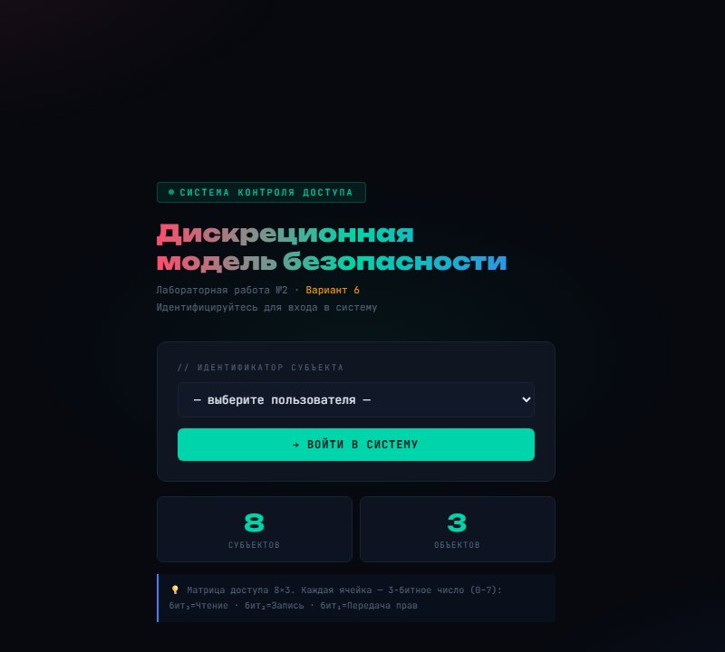
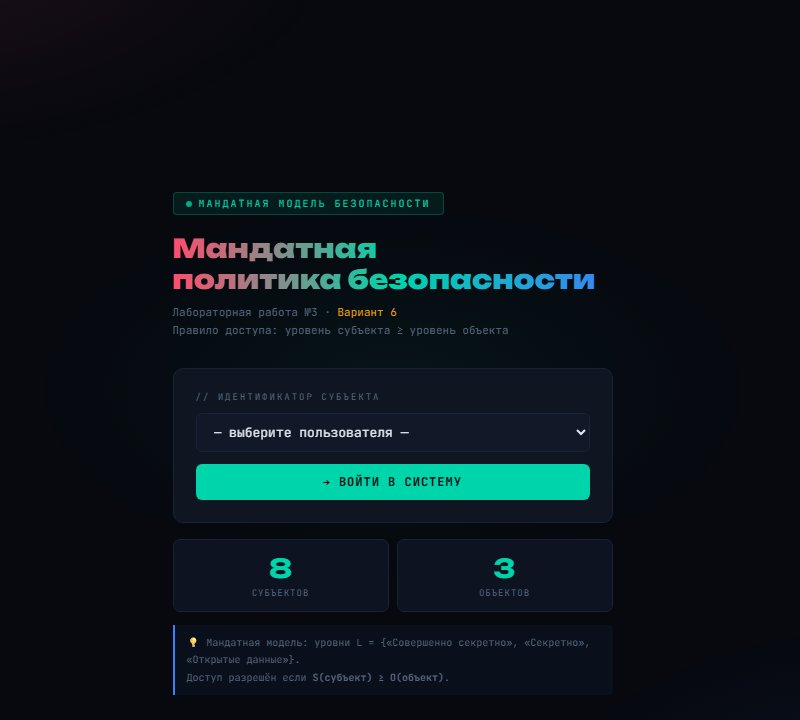
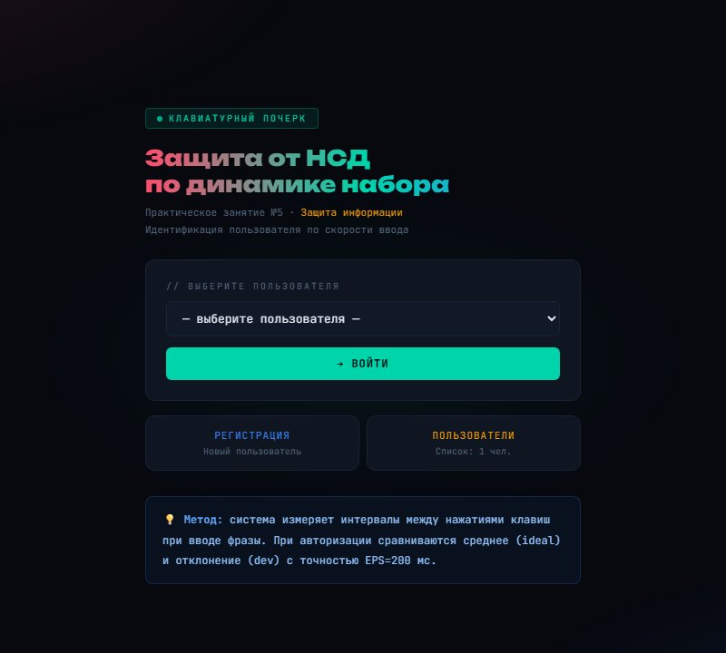
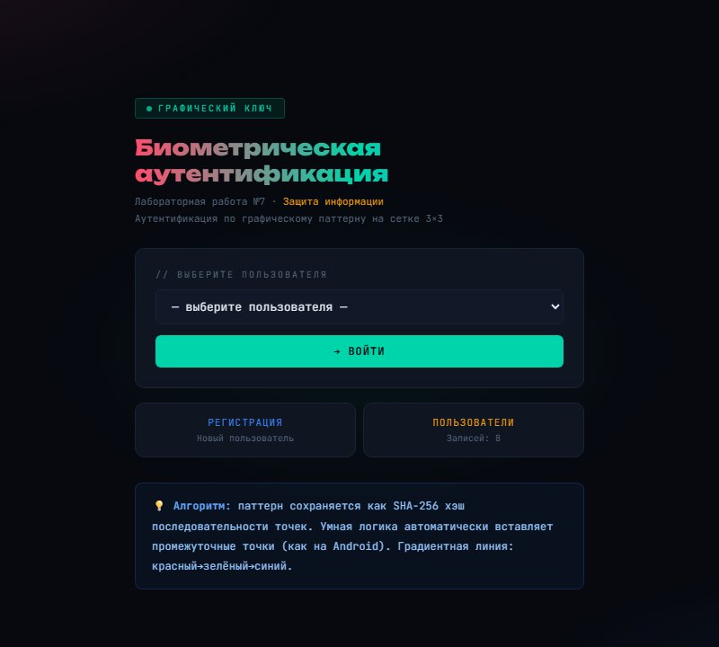
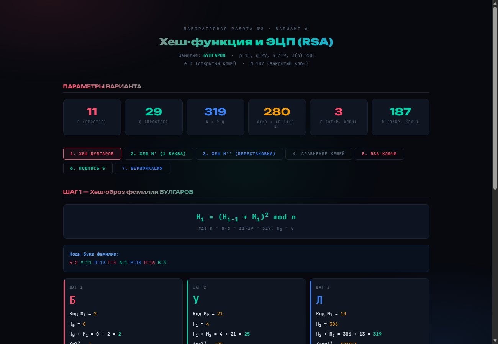

# Information Security Labs

Lab work from the **Information Security** course (3rd year, semester 6) at Don State Technical University (DSTU).
Each lab is a small **Flask** web application with its own interface that implements a security model or an authentication method and shows the calculations step by step. The interface is in Russian.

| Lab | Topic | What is implemented |
|---|---|---|
| [2](lab2-discretionary-access) | Discretionary access control | Access matrix of subjects × objects with rights encoded as bit masks; login as a subject, check and transfer of rights |
| [3](lab3-mandatory-access) | Mandatory access control | Three security levels (public → secret → top secret) randomly assigned to subjects and objects; access decisions by comparing the subject's clearance with the object's classification |
| [5](lab5-keystroke-dynamics) | Keystroke dynamics authentication | Measuring the intervals between key presses while typing a phrase; registration stores the mean interval and its deviation, login is accepted within a tolerance of 200 ms; temporary lock-out after failed attempts |
| [7](lab7-graphic-key) | Graphical password | Pattern drawn on a grid or free-hand; the pattern is normalised and stored as a **salted SHA-256** hash; smart insertion of skipped intermediate points (as on Android); lock-out after 5 failed attempts |
| [8](lab8-hash-and-rsa) | Hash function and digital signature | Own hash function `Hᵢ = (Hᵢ₋₁ + Mᵢ)² mod n` with every step shown, avalanche demo (one changed letter, two swapped letters); **RSA** key generation (extended Euclid, modular inverse), signing and verification |

## Screenshots

| Discretionary access | Mandatory access |
|---|---|
|  |  |
| **Keystroke dynamics** | **Graphical password** |
|  |  |

**Hash function and RSA signature**



## Repository structure

```
labN-.../
  app.py        main version of the lab
  variants/     the same lab solved for other task variants (different parameters and input words)
  drafts/       earlier versions
  *.dat         mock user data used by the demo (stored XOR-obfuscated, as required by the task)
```

## How to run

```bash
pip install flask
cd lab8-hash-and-rsa
python app.py        # http://127.0.0.1:5000
```

## Tech stack

Python · Flask · HTML / CSS / JavaScript · hashlib (SHA-256)

## License

[MIT](LICENSE)
